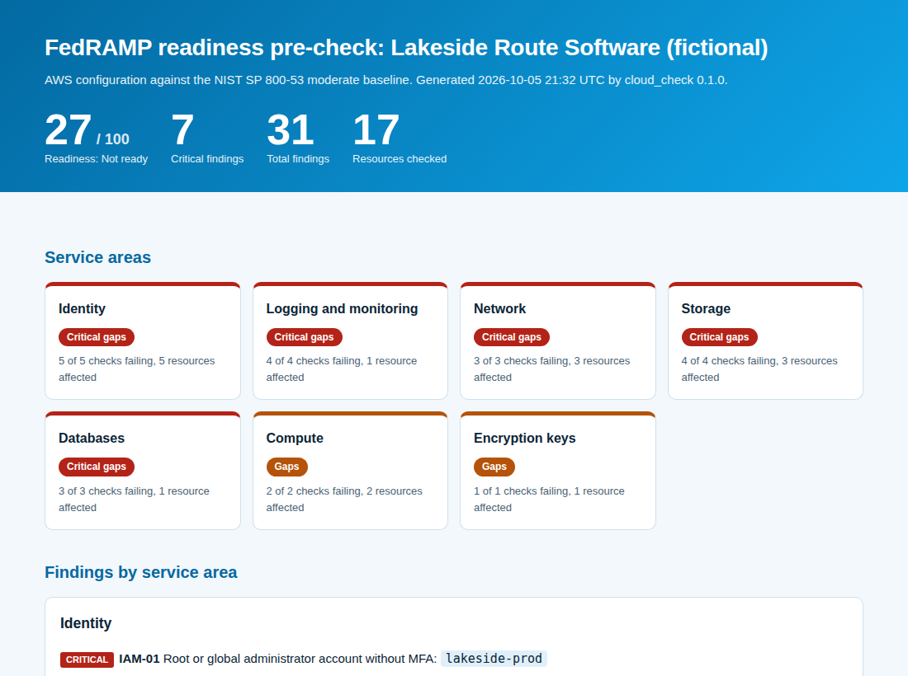

# FedRAMP Cloud Analyzer

[](https://github.com/Edward-Owusu/fedramp-cloud-analyzer/actions/workflows/tests.yml)
[](LICENSE)
[](https://doi.org/10.5281/zenodo.23172865)
[](https://fedramp-cloud-analyzer.streamlit.app)

An open-source **readiness pre-check** that reviews a cloud environment's configuration against FedRAMP-aligned **NIST SP 800-53 Rev. 5** controls. It groups results into service areas (identity, logging, network, storage, databases, compute, and encryption keys), names every misconfigured resource, and explains each fix in plain language.

It is built for **small cloud and software-as-a-service providers**, the kind of companies that build specialized tools for logistics, manufacturing, and other supply chains, that want to serve federal agencies but need to know where they stand before paying for a formal assessment.



## Why this matters

Federal agencies use the Federal Risk and Authorization Management Program (FedRAMP) to approve the cloud services they buy. Congress codified the program in the FedRAMP Authorization Act of 2022, and FedRAMP's more recent modernization efforts aim to make authorization faster and more automated.

Even so, preparing for a FedRAMP assessment takes significant time and money, and many small providers do not know how far their environment is from the baseline until a paid assessment tells them. Common configuration gaps, such as public storage, databases reachable from the internet, missing audit trails, and administrators without MFA, are cheap to fix early and expensive to discover late.

This tool gives small providers a free first look: a prioritized list of configuration gaps mapped to the controls an assessor will examine, so they can fix the basics before a formal engagement. A broader base of secure, assessment-ready small providers gives agencies more choice and strengthens the supply chain of cloud services the government depends on.

## What it does

- Runs **22 configuration checks** across **7 service areas**, mapped to **20 NIST SP 800-53 Rev. 5 controls**.
- Checks storage buckets, security groups, load balancers, servers, databases, cloud users, encryption keys, and account-wide logging and root account settings.
- Produces a **readiness score** and a status for each service area: Pass, Gaps, or Critical gaps.
- Names the **exact resource** behind each finding, with the control references and a plain-language fix.
- Supports the **low, moderate, and high** baselines and organization-defined parameters such as log retention and key rotation periods.
- Treats missing data conservatively: nothing passes without evidence.
- Works with a **provider-neutral inventory** format, so it can describe AWS, Azure, or Google Cloud environments.
- Produces reports in **HTML, Markdown, CSV, and JSON**, with a command-line tool and an interactive **Streamlit dashboard**.
- Has **no third-party dependencies** in its core engine.

## Quick start

Requires Python 3.10 or later.

```bash
git clone https://github.com/Edward-Owusu/fedramp-cloud-analyzer.git
cd fedramp-cloud-analyzer
pip install -e .

cloud-check samples/lakeside_route_software_aws.json --format html md
```

Example output:

```
Lakeside Route Software (fictional) | aws | Moderate baseline | 17 resources
Readiness: 27/100 (Not ready) | Findings: 31
  Identity                 Critical gaps
  Logging and monitoring   Critical gaps
  Network                  Critical gaps
  Storage                  Critical gaps
  Databases                Critical gaps
  Compute                  Gaps
  Encryption keys          Gaps
```

Open the HTML file in the `reports` folder for the full report. Pre-generated reports are in [docs/example-reports](docs/example-reports).

### Dashboard

```bash
pip install -r requirements.txt
streamlit run app/streamlit_app.py
```

Try the hosted version at https://fedramp-cloud-analyzer.streamlit.app, or run it locally:
### Use in automation

`--fail-on <severity>` exits with code 2 when a finding at or above that severity exists, so the check can run in a deployment pipeline:

```bash
cloud-check inventory.json --fail-on critical
```

## Checking your own environment

1. Build an inventory as described in the [inventory reference](docs/data-reference.md), using your provider's read-only inventory tools.
2. Optionally adjust parameters such as log retention in a policy file.
3. Run the tool, fix findings from the top, and run it again.

## Related projects

This is the fourth tool in a series of open-source GRC tools for small and mid-sized organizations:

- [NIST SP 800-53 Assessment Tool](https://github.com/Edward-Owusu/Nist-800-53-assessment-tool): system-level control assessment
- [Zero Trust IAM Auditor](https://github.com/Edward-Owusu/Zero-trust-iam-auditor): identity and access audit
- [MFA Compliance Tracker](https://github.com/Edward-Owusu/mfa-compliance-tracker): MFA rollout progress and bypass detection
- FedRAMP Cloud Analyzer (this project): cloud configuration readiness

## Data and limitations

All sample data is synthetic and does not describe any real organization. This tool is a readiness pre-check of configuration data. It is **not a FedRAMP assessment or authorization**, does not replace a Third Party Assessment Organization, and does not cover the policy, documentation, and continuous monitoring requirements of FedRAMP. See the [methodology](docs/methodology.md).

## References

- FedRAMP program: https://www.fedramp.gov
- NIST SP 800-53 Rev. 5, *Security and Privacy Controls for Information Systems and Organizations*: https://csrc.nist.gov/pubs/sp/800/53/r5/upd1/final
- NIST SP 800-53B, *Control Baselines for Information Systems and Organizations*: https://csrc.nist.gov/pubs/sp/800/53/b/upd1/final
- OMB Memorandum M-21-31, *Improving the Federal Government's Investigative and Remediation Capabilities Related to a Cybersecurity Incident* (August 2021)

## Author

**Edward Owusu, CISA**, GRC Analyst and IT Auditor.

Feedback, issues, and contributions are welcome. If you use this tool in your organization, I would be glad to hear how it worked for you; please open an issue or get in touch.

## Citation

If you use this tool in research or professional work, please cite it using the metadata in [CITATION.cff](CITATION.cff).

## License

[MIT](LICENSE)
